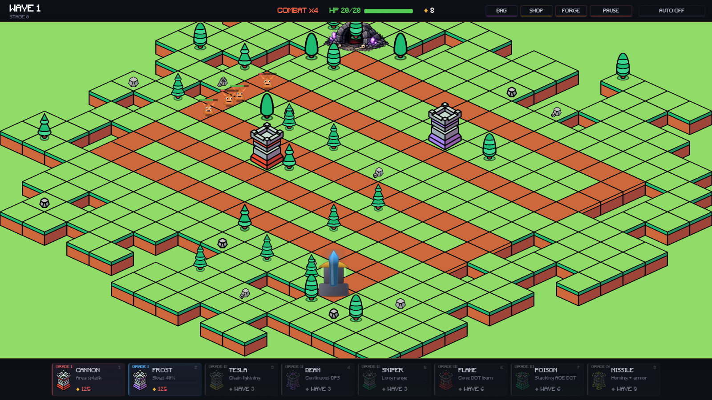
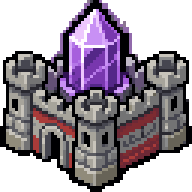
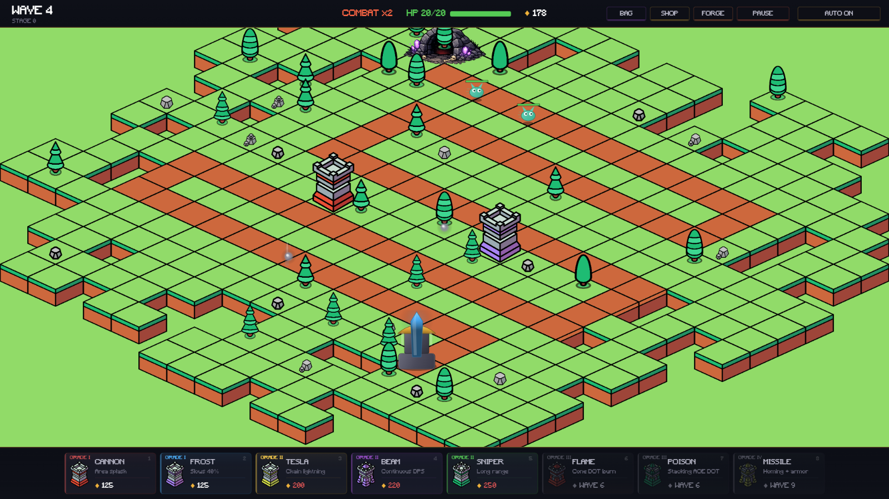
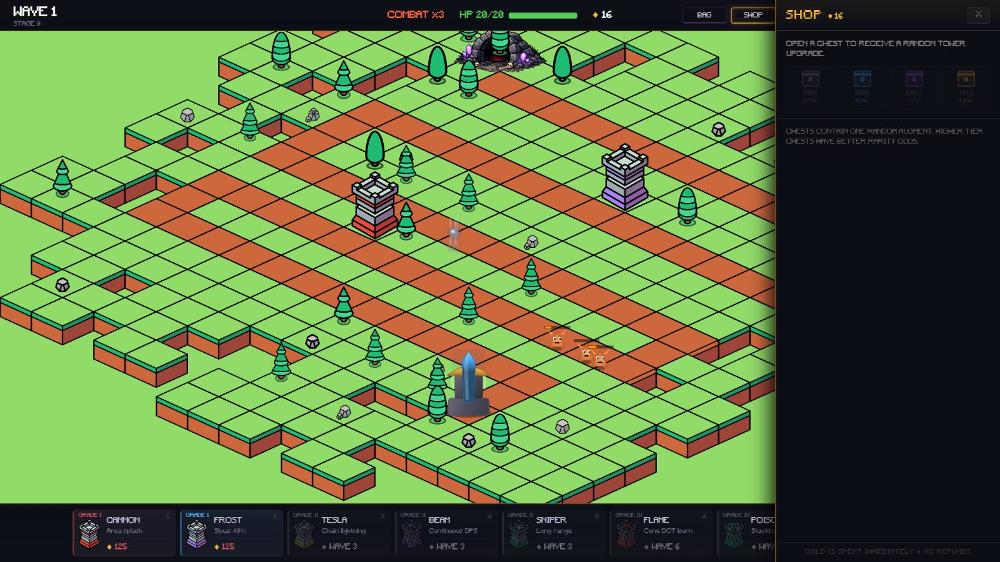
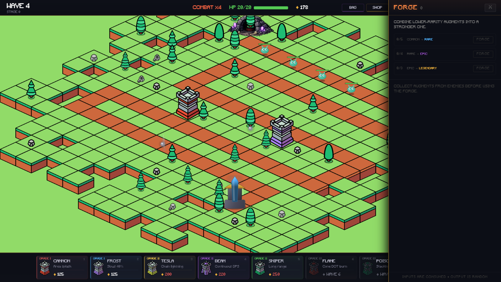

<p align="center"></p>

<p align="center"></p>

<h1 align="center">Tower MMO</h1>

<p align="center">
  <b>Изометрический tower defense, где из врагов падает лут.</b><br>
  <i>An isometric tower defense with RPG loot.</i>
</p>

<p align="center">
  
  
  
  
  
</p>

<p align="center">
  <a href="https://x1as.github.io/tower-mmo/"><b>▶ Играть в браузере</b></a> &nbsp;·&nbsp; <a href="#english">English</a>
</p>

> **В двух словах.** Классический TD, скрещённый с RPG: враги роняют аугменты разной редкости, ты вставляешь их в башни, а лишнее переплавляешь в кузнице во что-то редкое. Новые башни открываются по волнам, каждая пятая волна с боссом.

## Галерея

<table>
  <tr>
    <td width="50%"><br><sub><b>Волна 4.</b> С третьей волны открываются башни II грейда.</sub></td>
    <td width="50%"><br><sub><b>Магазин.</b> Сундук даёт случайный аугмент, у дорогих сундуков выше шанс на редкость.</sub></td>
  </tr>
  <tr>
    <td><br><sub><b>Кузница.</b> 5 обычных → 1 редкий, 4 редких → 1 эпический, 3 эпических → 1 легендарный.</sub></td>
    <td valign="top"><br><b>Статус: ранняя стадия.</b> Одна карта, волны, босс каждые 5 волн. Название осталось от первой версии с бэкендом; сейчас игра полностью клиентская.</td>
  </tr>
</table>

## Под капотом

- **8 башен в 4 грейдах.** Cannon и Frost доступны сразу, Tesla, Beam и Sniper с 3-й волны, Flame и Poison с 6-й, Missile с 9-й. Каждая следующая башня того же типа дороже.
- **9 типов врагов с сопротивлениями.** Одни режут урон от сплеша, другие не замедляются, не горят, уклоняются от снарядов, не получают урон от цепной молнии или восстанавливают броню. Каждая 5-я волна с боссом.
- **Лут.** Из врагов падают аугменты 8 видов и 4 редкостей, шанс зависит от стадии игры. Аугмент вставляется в башню, у башни до 10 слотов.
- **Изометрия.** Карта 14×14, тайлы и башни собираются из PNG, враги, снаряды и эффекты рисуются процедурно (`SpriteGenerator.ts`). Любой процедурный спрайт можно заменить своим PNG в `src/game/sprites/custom/`.
- **React поверх Phaser.** Игровой цикл, волны и бой живут в сцене Phaser; HUD, магазин, инвентарь и кузница сделаны на React. Сцена отдаёт состояние в React через события.

## Стек

TypeScript · Phaser 3 · React 19 · Vite · GitHub Actions (деплой на Pages).

## Запуск

```bash
pnpm install
pnpm dev        # http://localhost:5173/tower-mmo/
pnpm build      # сборка в dist/
```

При пуше в `main` GitHub Actions собирает проект и кладёт `dist/` в ветку `gh-pages`, откуда её раздаёт GitHub Pages.

## Управление

`1`–`8` выбрать башню, клик по клетке поставить, клик по башне выбрать её. `Enter` или `Space` запустить волну (во время боя `Space` ставит паузу). `Esc` меню. Кнопки BAG, SHOP, FORGE и AUTO вверху.

## Структура

| Путь | Что внутри |
|---|---|
| `src/game/scenes/GameScene.ts` | карта, волны, бой, лут, размещение башен |
| `src/game/scenes/BootScene.ts` | загрузка и сборка изометрических спрайтов |
| `src/game/sprites/SpriteGenerator.ts` | процедурные спрайты врагов, снарядов, эффектов |
| `src/shared/constants.ts` | баланс: башни, враги, волны, таблица лута, рецепты кузницы |
| `src/shared/loot-roll.ts` | броски лута |
| `src/components/` | React-интерфейс: HUD, магазин, инвентарь, кузница, меню |

## Что дальше

`GameScene.ts` разросся до 1500 строк: следующий шаг вынести волны, бой и лут в отдельные системы и покрыть баланс тестами. Линтер пока ругается на `any` и неиспользуемые переменные.

---

<a id="english"></a>
## English

**Tower MMO** is an isometric tower defense with RPG loot, early stage: 8 towers unlocked by wave, 9 enemy types with resistances, a boss every 5 waves, augments of 8 kinds and 4 rarities, chests and a forge. The game loop runs in Phaser 3, the HUD and menus are React. Client-only, deployed to GitHub Pages by GitHub Actions.

▶ **[Play in the browser](https://x1as.github.io/tower-mmo/)**

---

<p align="center"><sub>Сделано <a href="https://github.com/x1as">@x1as</a> · 2026 · <a href="https://x1as.github.io/">портфолио</a></sub></p>
